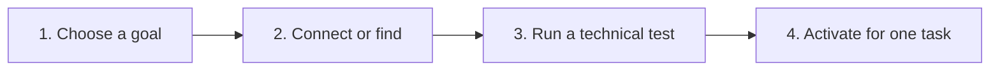

# AI Setup

AI Setup is the single entry point for optional model configuration. The built-in demo remains usable without an external model. Advanced discovery, download, and inference controls stay hidden until the user opens them.

## Setup flow

MedRay binds a successful test to the exact backend, provider, endpoint, model, task, cloud permission, and saved-key state. Changing any of those values requires a new test.

## Sections

| Section | Purpose |
| --- | --- |
| Quick Setup | Choose a beginner-friendly starting path. |
| Local AI | Connect Ollama or an OpenAI-compatible local runtime. |
| Online AI | Connect a hosted OpenAI-compatible provider with explicit data-egress consent. |
| X-ray Classifiers | Install, test, compare, and activate reviewed chest X-ray classifier recipes. |
| My Models | Review active task assignments, detected models, and local artifacts. |
| System Check | Inspect application components and local hardware. |
| Find Models | Search Hugging Face, GitHub, and installed Ollama models. |
| Downloads | Manage resumable downloads and optional SHA-256 verification. |
| AI Preferences | Configure review depth, sampling, timeouts, retries, annotation thresholds, and anatomy routing. |

## Supported AI servers

Ollama uses its native API. Local OpenAI-compatible presets include LM Studio, llama.cpp, vLLM, LocalAI, Jan, Hugging Face TGI, LiteLLM, and a custom compatible server. Hosted presets include OpenAI, OpenRouter, Groq, Together AI, and a custom compatible provider.

Support is verified per task. A server may support text chat but not image input, structured report output, or a particular sampling option. “Compatible” describes the protocol, not clinical suitability.

Vision, chat, and report drafting keep independent tested assignments. For example, LM Studio may handle image review while Jan handles chat and a hosted provider drafts reports. Replacing one assignment does not clear the others.

Remote endpoints require HTTPS and explicit cloud permission. Plain HTTP is accepted only for loopback addresses on the same computer. API keys are stored locally and scoped to the endpoint that uses them.

## Local server workflow

1. Install and open the selected runtime.
2. Load a model that supports the intended task.
3. Enable the runtime's API server.
4. Open **AI Setup → Local AI** and select the runtime.
5. Select a task, detect models, and choose one model.
6. Run the synthetic technical test.
7. Activate the tested model for that task.

Image review sends a locally encoded PNG through a compatible image-content request. It therefore requires both a vision-capable model and a server that accepts that request format.

## Specialist chest X-ray classifiers

The **X-ray Classifiers** section separates pathology classification from VLM review and annotation. Four reviewed TorchXRayVision recipes are available:

| Recipe | Training source | Intended use |
| --- | --- | --- |
| DenseNet-121 All-Datasets | Multiple public CXR cohorts | Broad starting baseline. |
| DenseNet-121 NIH | NIH ChestX-ray8 | NIH-specific comparison. |
| DenseNet-121 CheXpert | CheXpert | CheXpert-specific comparison. |
| DenseNet-121 RSNA | RSNA Pneumonia Challenge | Narrow pneumonia/lung-opacity comparison. |

Each recipe follows the same guided path: install pinned CPU dependencies, download an official release artifact, verify its SHA-256 digest, run a synthetic inference test in a subprocess, and then allow activation. Dataset-specific models expose only labels trained by that dataset. Their scores remain uncalibrated research signals and require local validation.

The automatic CPU recipe supports Windows or Linux x86-64 with Python 3.10–3.12 inside the MedRay virtual environment. GPU, macOS, and other architectures use the official [PyTorch installation selector](https://pytorch.org/get-started/locally/) before returning to the same test and activation flow.

## Model discovery and downloads

Find Models provides optional Hugging Face and GitHub sign-in, combined or source-specific search, hardware guidance, task filters, ranking, pagination, repository details, and file selection. Fit percentages are triage hints, not compatibility or quality guarantees.

Downloaded or imported files are never activated automatically. Repository scripts are not executed, and MedRay does not use `trust_remote_code=True`. A raw artifact needs a matching runtime adapter, model-card review, license review, and technical test.

The download manager supports 1–16 HTTP range connections, pause, resume, cancellation, retry, deterministic segment assembly, and optional SHA-256 verification. It falls back to a single stream when ranges are unavailable.

## Advanced inference controls

- Review depth: focused, balanced, or thorough.
- Temperature: 0–2.
- Top-p: bounded nucleus sampling.
- Seed: deterministic where the provider supports it.
- Maximum output: 128–32,768 tokens.
- Request timeout: 10–900 seconds.
- Retry count: 0–5.
- Localization and annotation thresholds.
- Per-anatomy routing overrides.

These controls alter generation behavior; they do not increase clinical validity. Change one control at a time when comparing runs and save the runtime snapshot with validation evidence.

## AI annotations

A VLM may propose up to ten normalized `xyxy` boxes in a single `MEDRAY_ANNOTATIONS_JSON` block. MedRay rejects malformed JSON, empty labels, out-of-range confidence, invalid geometry, and coordinates mentioned only in prose. Accepted coordinates are converted to source-image pixels and remain `unreviewed` until a human accepts, edits, or rejects them.

The Reading Room exposes annotation origin, AI confidence, review state, filters, batch review, revision history, and a rerun action. A classifier score is not a localization and never creates a box by itself.

## Readiness and safety

“Downloaded” means that an artifact exists. “Ready” means that the exact technical test passed. Neither status establishes clinical performance. MedRay is for research, education, and prototyping and is not an authorized diagnostic device. Every output requires qualified physician review.

See [AI Setup verification](AI_SETUP_VERIFICATION.md), [Safety](SAFETY.md), and [Model Finder](MODEL_FINDER.md) for implementation limits.
