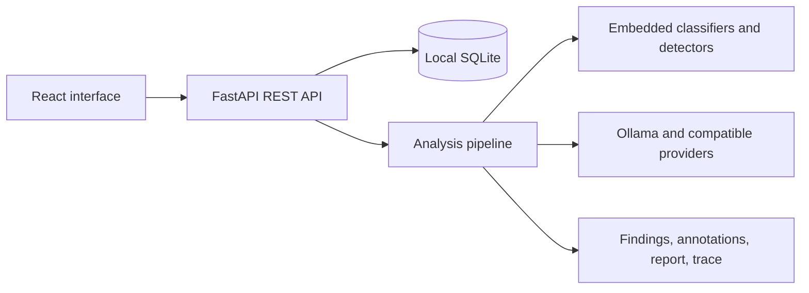

# Architecture

MedRay v2 uses a FastAPI backend, a React/Vite frontend, and local SQLite storage.

## Main modules

- `backend/app/api`: case, analysis, runtime, export, and model APIs.
- `backend/app/models`: Pydantic contracts for cases, results, annotations, reports, and runtime state.
- `backend/app/storage`: local SQLite persistence and migrations.
- `backend/app/pipelines`: anatomy routing, image review, classifier, annotation, and report composition.
- `backend/app/ai_setup`: provider tests, specialist classifier recipes, downloads, and system checks.
- `backend/app/runtime`: Ollama and OpenAI-compatible adapters, endpoint policy, and scoped secrets.
- `backend/app/model_finder`: Hugging Face, GitHub, Ollama, local imports, and download jobs.
- `backend/app/medrax_adapter`: narrow external-tool contracts and normalized traces.
- `frontend/src`: Dashboard, Reading Room, Case Library and validation, Guide, AI Setup, and About.

## Runtime model

Vision, chat, and report drafting each store an independently tested provider connection. Embedded classifier and localization slots remain separate because their outputs have different contracts. Every analysis persists a runtime snapshot and provenance trace.

## Data boundary

Cases, keys, downloads, and settings are local by default. A remote provider is blocked until the user explicitly enables data egress, and non-loopback providers must use HTTPS. Source images are never modified in place.
