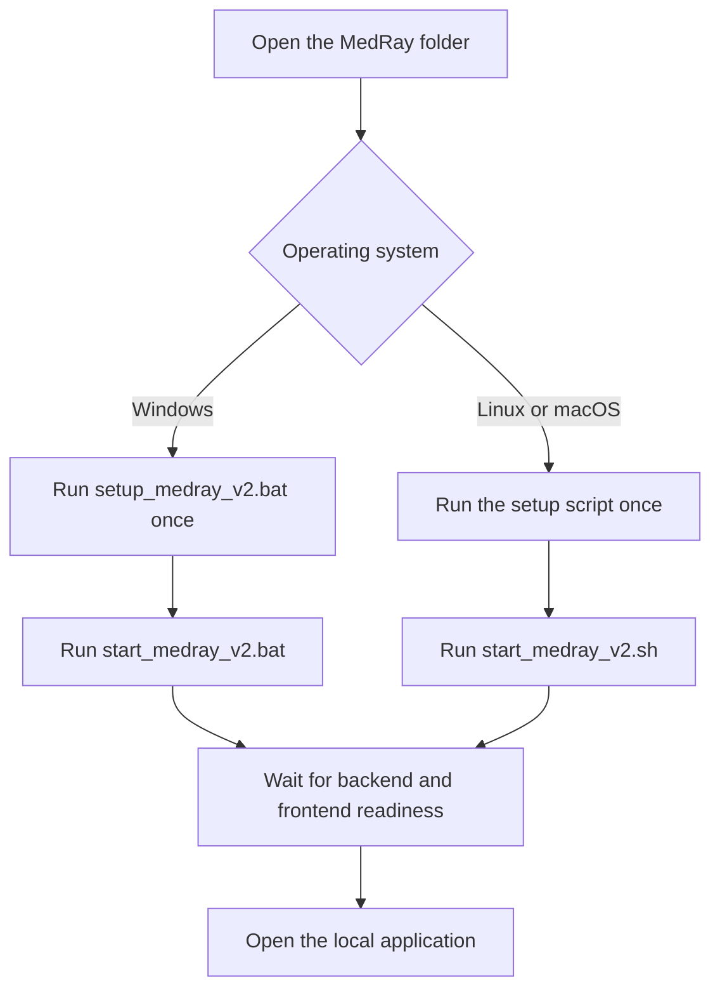
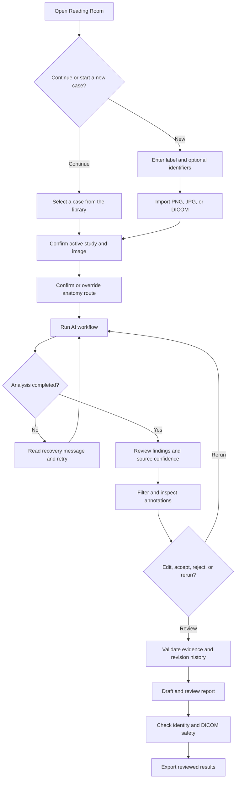
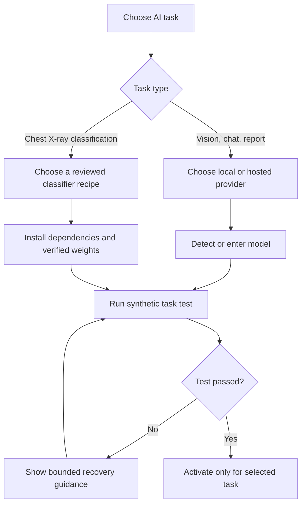

# GUI Redesign and Workflow

MedRay's interface centers one continuous research workflow:

`Import study → Run analysis → Review evidence → Validate annotations → Draft report → Export`

The application remains a research, education, and prototyping tool and is not an authorized diagnostic device.

## Design decisions

- Daily navigation contains Dashboard, Reading Room, Case Library, Guide, AI Setup, and About.
- The Reading Room exposes one primary next action at each stage while keeping specialist tools available.
- New cases and case switching reset transient state without a browser refresh.
- Anatomy routing, case metadata, prompts, image settings, and technical traces use progressive disclosure.
- Case registry and validation form one continuous workspace; the case list scrolls independently for large libraries.
- AI Setup uses a four-stage connection flow and keeps advanced controls optional.
- Light and dark themes share the same hierarchy, contrast targets, and optical logo alignment.

## Application startup

## Reading workflow

## AI configuration workflow

## Safe-use checklist

- Confirm the case and active image before analysis.
- Keep automatic anatomy routing unless the metadata or image clearly requires correction.
- Distinguish classifier scores, VLM observations, AI coordinates, fallback regions, and human annotations.
- Review origin, confidence, uncertainty, evidence, and revisions before accepting an annotation.
- Do not promote unreviewed output into a final report.
- Review patient tags, private tags, UID handling, and burned-in pixels before DICOM export.
- Require qualified physician verification for every output.

## Validation target

Test the interface with representative users performing startup, multi-image import, analysis, case switching, annotation correction, report review, and risky-export interception. Measure task completion, time, errors, assistance, near misses, and System Usability Scale scores. Applying established patterns is not itself usability validation.
